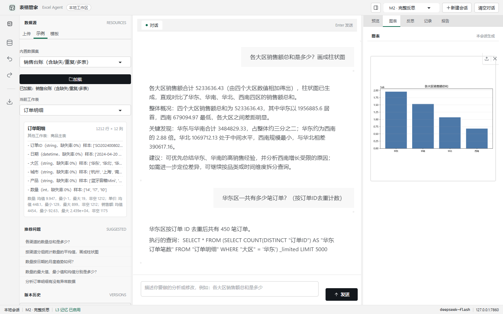
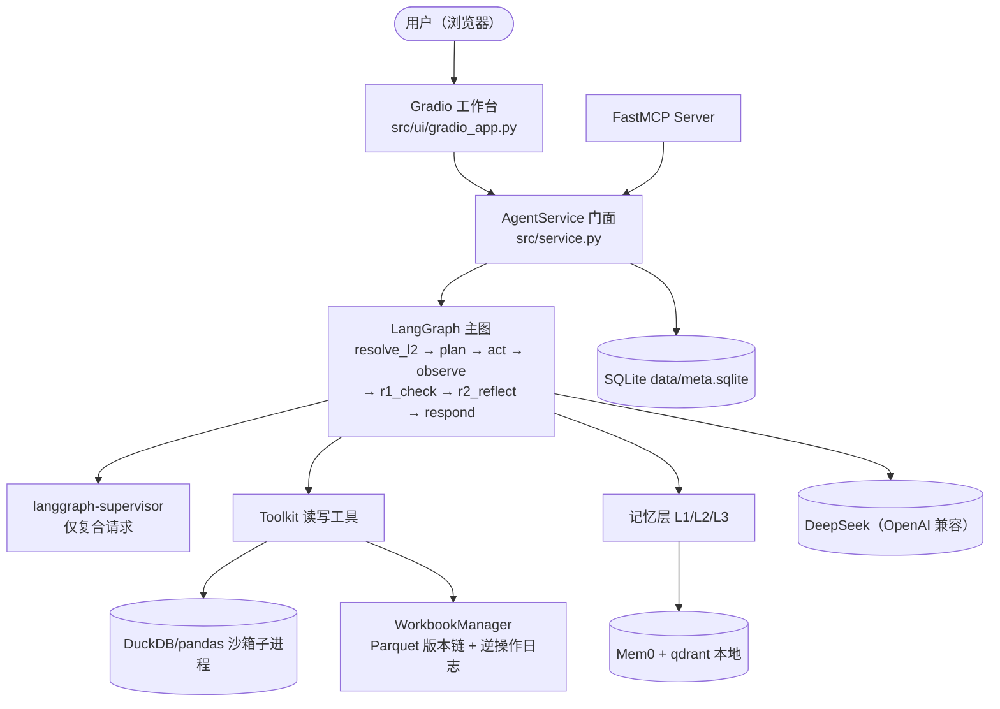

# Excel 对话式数据分析智能体

上传或选择一份表格，用中文对话完成「**看清数据 → 清洗整理 → 分析出图 → 得出结论 → 改数交付**」。
全过程可追溯（每个数字都能复现）、可撤销（逆操作日志 + 版本快照）、会反省（三层反思闭环）。

> 学校专业实习课程项目（vibe coding / 用成熟 AI Agent 工具快速开发）。
> 需求基线见《[Excel智能体-规格说明书.md](Excel智能体-规格说明书.md)》；**实现文档见 [docs/](docs/README.md)**。

| 能力 | 说明 |
|---|---|
| 看懂 | schema 抽取 + 语义理解，表格数据永不整块进入 LLM 上下文 |
| 改得动 | 16 个结构化写操作：diff 红绿预览 → 确认 → 逆操作日志 → 可撤销 |
| 记得住 | L1 会话摘要 + L2 工作记忆 + L3 Mem0 长期记忆，「那华南呢」直接懂 |
| 会反省 | R1 规则校验 → R2 独立复核 → R3 澄清，过程在界面可见 |

## 快速启动

```powershell
py -3.11 -m venv .venv
.venv\Scripts\python.exe -m pip install -r requirements.txt
copy .env.example .env        # 编辑 .env，填入你的 DeepSeek Key
.venv\Scripts\python.exe app.py
```

浏览器打开 `http://127.0.0.1:7860`（首次启动预热约 30–40 秒）。
详细安装、数据目录与故障排查见 [docs/09 部署与运维](docs/09-deployment-ops.md)。

## 演示视频

完整功能演示（**2 分 25 秒**，1280×720，H.264）：[recordings/excel_agent_demo.mp4](recordings/excel_agent_demo.mp4)
（配音与字幕制作指南见 [docs/11 演示视频脚本](docs/11-demo-script.md)）

| 时间 | 内容 |
|---|---|
| 0:00 | 标题 |
| 0:03 | 载入示例数据（销售台账）→ 首轮聚合问答 |
| 0:18 | 追问「把上面的结果画成柱状图」→ 图表 |
| 0:29 | 异常诊断 + 相关性分析 → 切到「反思」查看 R1/R2 轨迹 |
| 0:45 | 追问「那华南呢」→ 华南月度明细表（L2 指代消解） |
| 1:02 | 「把华南每月销售额画成折线图」→ 折线图 |
| 1:14 | 均值填充缺失值 / 单元格编辑：diff 预览 → 确认 → 撤销 |
| 1:38 | 生成月度经营小结 → 「报告」页 → 导出 xlsx / PDF |
| 2:03 | 新建会话 → 历史回放 → 记忆面板（L1/L2/L3）→ 快照恢复 |



## 架构



三条铁律（规格 §7）：**写操作单一入口且串行**（只有 Writer/确认按钮能落盘，全局写锁）；**读/分析可并行**；**简单请求零多 Agent 开销**。
完整组件图、模块地图与设计决策见 [docs/02 总体架构](docs/02-architecture.md)、[docs/03 Agent 设计](docs/03-agent-design.md)。

## 评测摘要

| 配置 | 30 题成功率 | 平均耗时/题 | 平均重试 |
|---|---|---|---|
| M0 无反思 | 30/30（100%） | 11.2s | 0.00 |
| M1 仅 R1 | 30/30（100%） | 11.0s | 0.00 |
| **M2 R1+R2（采用）** | **30/30（100%）** | **20.8s** | 0.03 |

- **AC-7 如实说明**：M0 首轮生成质量已达 30/30，反思提升为 0pp（目标 ≥10pp 未达标，未修饰数据）。
  归因与逐题证据见 [docs/10 测试与评测](docs/10-testing-eval.md)。
- 性能：10 万行单轮查询热态 **5.2s**（≤10s 达标）；冷启动预热 29.1s（一次性）。
- 完整报告：[eval/report.md](eval/report.md)；复现方法：[docs/10](docs/10-testing-eval.md#6-复现命令)。

## MCP Server

```powershell
.venv\Scripts\python.exe -m src.mcp_server.server   # stdio 传输
```

9 个 tools + `excel://{workbook_id}/schema` resource；写操作与 UI 同一 propose → confirm 语义。
参数与调用示例见 [docs/05 工具与 MCP](docs/05-tools-mcp.md)。

## 文档

| 文档 | 内容 |
|---|---|
| [docs/README](docs/README.md) | 文档导航与阅读路径 |
| [01 需求与验收](docs/01-requirements.md) | FR/AC 清单、追踪矩阵、AC-7 归因 |
| [02 总体架构](docs/02-architecture.md) | 组件图、请求生命周期、技术选型、设计决策 |
| [03 Agent 设计](docs/03-agent-design.md) | 主图、反思闭环、supervisor、写确认时序 |
| [04 数据与存储](docs/04-data-storage.md) | SQLite 表、版本链、撤销语义 |
| [05 工具与 MCP](docs/05-tools-mcp.md) | 工具清单、diff/确认、MCP 接口 |
| [06 沙箱与安全](docs/06-sandbox-security.md) | 三层防线、密钥管理 |
| [07 记忆层](docs/07-memory.md) | L1/L2/L3、指代消解、降级 |
| [08 用户手册](docs/08-user-guide.md) | 界面操作全指南、FAQ |
| [09 部署与运维](docs/09-deployment-ops.md) | 安装、数据目录、排障、发布前检查 |
| [10 测试与评测](docs/10-testing-eval.md) | 52 个单测、30 题评测、性能 |
| [11 演示视频脚本](docs/11-demo-script.md) | 分镜、台词、TTS/字幕指南 |
| [12 项目管理](docs/12-project-management.md) | 里程碑、风险、已知问题、路线图 |

## 降级与已知限制（摘要）

未配置 Key 时界面可用但对话不可用；Mem0 初始化失败自动降级 L3（L1/L2 不受影响）；
冷启动 29–40s；`.xls` 不支持合并单元格填充；MCP 为单会话。
完整清单与规格偏差见 [docs/12](docs/12-project-management.md#4-已知问题与规格偏差)、[docs/09](docs/09-deployment-ops.md#6-故障排查表)。

## 许可证

[MIT](LICENSE)
