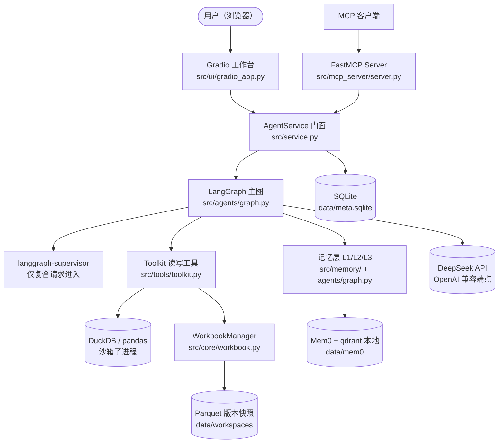
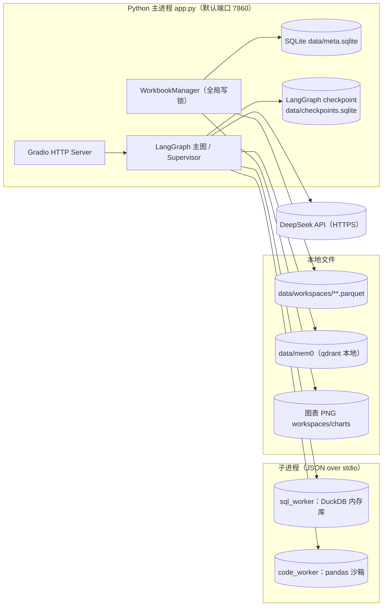

# 02 · 总体架构

> 本文档描述 **按实际实现** 的系统结构。需求侧描述见规格书 §1。

## 1. 系统上下文



要点：

- **表格数据永不整块进入 LLM 上下文**：给模型看的只有 schema 摘要（列名/类型/缺失率/样本值）、统计摘要与查询结果前 N 行（`Toolkit.result_to_context` ≤20 行）。
- **写操作走结构化工具**：模型只能选择 12 个预定义写操作并填参数，不能生成改表代码；见 [05 工具与 MCP](05-tools-mcp.md)。
- **每个数字可溯源**：回答附带「执行的查询」，SQL 与结果存 `result_refs`，可在「查询记录」页复现。

## 2. 分层与组件地图

| 层 | 组件 | 职责 | 关键文件 |
|---|---|---|---|
| 交互层 | Gradio 工作台 | VSCode 套壳式 UI：数据源/对话/检查器/会话/导出/流式停止 | `src/ui/gradio_app.py` |
| 门面层 | `AgentService` | UI/评测/MCP 统一入口：一轮对话、写确认流、版本操作、会话管理、L1 压缩 | `src/service.py` |
| 编排层 | LangGraph 主图 | resolve_l2 → plan → act → observe → r1_check → r2_reflect → respond | `src/agents/graph.py`、`nodes.py` |
| 编排层 | Supervisor | 仅复合请求（intent=complex 且非重试）进入；6 个 worker 分工 | `src/agents/supervisor_app.py`、`workers.py` |
| 记忆层 | L1/L2/L3 | checkpoint+滚动摘要 / SQLite 工作记忆 / Mem0 语义记忆 | [07 记忆层](07-memory.md) |
| 工具层 | Toolkit | inspect/query/chart/join/summarize/diagnose/correlate/forecast/compute + plan_write | `src/tools/toolkit.py` |
| 工具层 | 写执行器 | 16 个结构化写操作 + diff + 逆操作 | `src/core/mutations.py`、`diff.py` |
| 执行层 | SQL 沙箱 | 持久子进程 + DuckDB 内存库 + 三层防线 | `src/sandbox/` |
| 数据层 | WorkbookManager | 版本链、ops 逆操作日志、undo/redo/goto/snapshot、样式、导出 | `src/core/workbook.py` |
| 数据层 | Storage | SQLite 元数据/会话/聊天/结果引用（线程安全单例） | `src/core/storage.py` |
| 对外 | FastMCP Server | 9 tools + 1 resource，写语义与 UI 一致 | `src/mcp_server/server.py` |
| 配置 | config/llm | `.env` 唯一读取处、路径/限额常量、模型工厂（带缓存） | `src/config.py`、`src/llm.py` |

## 3. 一次请求的生命周期

**简单请求（simple_query，零多 Agent 开销）**：

1. UI 把用户输入交给 `AgentService.chat()`（`src/service.py#chat`）。
2. `resolve_l2` 读取 L2 工作记忆 + L3 检索，做指代消解（详见 [07 记忆层](07-memory.md)）。
3. `plan` 由 LLM 输出步骤计划（JSON），并判定 intent（simple_query/chart/diagnose/forecast/write/join/report/complex/clarify/chat）。
4. `act` 逐步执行：生成 SQL → 沙箱执行 → 结果写 `result_refs` 并回写 L2。
5. `r1_check` 规则校验（m0 直接通过）；失败按模式走重试/R2。
6. `respond` 叙述者基于执行观察成文（禁止编造），流式输出 token。

**复合请求（intent=complex）**：`act` 把 schema + L2 上下文交给 supervisor（`supervisor_app.py#run_supervisor`），
由 supervisor 在 6 个 worker 间路由聚合；异常时降级回主图逐步执行。

**写请求**：`act` 只生成 `pending_write`（diff 预览，不落盘），`respond` 输出确认卡；
用户确认后 `AgentService.confirm_write()` 在全局写锁内 `apply_write()`。详见 [03 Agent 设计](03-agent-design.md#5-写操作确认流)。

## 4. 技术选型与版本

| 层 | 选型 | 版本（requirements.txt 锁定） | 选型理由 |
|---|---|---|---|
| 编排 | LangGraph | 1.2.17 | 显式状态图 + checkpoint，反思/重试天然可建模 |
| 多 Agent | langgraph-supervisor | 0.0.31 | hub-and-spoke 路由，worker 分工 |
| 记忆 | mem0ai（自托管） | 2.2.1 | 提取/合并/检索齐全，本地 qdrant 免 API 费 |
| Embedding | sentence-transformers（本地 MiniLM） | 6.2.0 / torch 2.14.1 | 离线、中文支持（paraphrase-multilingual-MiniLM-L12-v2，384 维） |
| MCP | fastmcp | 4.1.3 | tools + resources 标准化暴露 |
| 查询 | DuckDB | 2.0.0 | SQL 直查 Parquet、列式、隔离性好 |
| 数据 | pandas / pyarrow / openpyxl / xlrd | 3.1.0 / 26.0.0 / 3.1.5 / 2.0.2 | 读写 Excel/Parquet |
| SQL 校验 | sqlglot | 30.24.0 | 解析 AST 做列名/函数白名单 |
| 统计 | scipy | 1.17.1 | Pearson/Spearman + p 值 |
| 图表/导出 | matplotlib / reportlab | 3.11.2 / 5.1.0 | PNG 图与 PDF 报告（中文字体） |
| 界面 | Gradio | 6.30.0 | 快速出可演示 Web UI |
| 存储 | SQLite | 标准库 sqlite3 | 零运维元数据/会话/日志 |

## 5. 运行拓扑

单机单进程 + 两个常驻子进程；所有持久化都在本地文件系统。



- 子进程由 `SqlRunner`/`CodeRunner` 管理：5 秒超时杀进程并重建（详见 [06 沙箱与安全](06-sandbox-security.md)）。
- Mem0 本地 qdrant 有进程级迁移目录锁：**应用与评测都是单实例/串行**，后启动者自动降级 L3。
- 端口与数据根可用环境变量覆盖：`EXCEL_AGENT_PORT`、`EXCEL_AGENT_DATA_ROOT`（演示/评测隔离用）。

## 6. 关键设计决策

| 决策 | 理由 | 代价/权衡 |
|---|---|---|
| 表数据不进上下文，只给 schema+统计+前 N 行 | 10 万行与 100 行 token 成本一致；防提示注入 | 复杂口径需多轮查询 |
| 写操作 = 结构化工具 + diff 预览 + 逆操作日志 | 可撤销（AC-5）、可审计、可预览 | 模型不能自由改表，灵活性受限 |
| DuckDB 查 Parquet，而非 pandas 硬算 | 不进内存、SQL 易静态校验 | 需维护 worker 生命周期 |
| R1（规则）先行、R2（LLM 复核）兜底 | 规则毫秒级且确定；R2 独立上下文防自我辩护 | R2 增加时延（M2 平均 20.8s/题） |
| 简单请求直连，复合请求才进 supervisor | 「问一句也慢」不可接受 | planner 需准确判定意图 |
| Mem0 自托管 + 本地 embedding | 免 API 费、数据可控、可离线 | 冷启动加载模型约 30–40s；进程锁限制并发 |
| SQLite + Parquet 文件 | 零运维、一条命令启动 | 单机；不支持多用户并发写 |

## 7. 目录结构

```
app.py                  # 入口：预热（Mem0 + SQL 沙箱）→ Gradio 启动
src/
  config.py  llm.py     # .env 唯一读取处；路径/限额常量；模型工厂（带缓存）
  core/                 # importer（脏表/编码）schema_extract storage(SQLite)
  │                     # workbook（唯一句柄+版本链+undo） mutations（写执行器） diff
  sandbox/              # sqlguard（白名单校验） runner sql_worker code_runner code_worker
  tools/                # toolkit（读工具统一入口） chart analytics exporter
  memory/               # working(L2) longterm(Mem0 L3)
  agents/               # graph nodes state reflector prompts workers supervisor_app events
  mcp_server/           # FastMCP Server（server.py；启动见 docs/05）
  ui/                   # gradio_app.py（VSCode 套壳工作台，Lucide 图标、无 emoji）
templates/              # 5 个 YAML 模板（销售/考勤/成绩/库存/问卷）
samples/                # 3 个示例 + dirty/ 3 张脏表（scripts/make_samples.py 固定种子生成）
eval/                   # evalset.json(30题) run.py scoring.py judge.py make_report.py perf_test.py
tests/                  # pytest（无 Key 可跑）
docs/                   # 本文档目录
recordings/             # 演示视频成片（raw/ 原始分段不入库）
scripts/                # make_samples.py / ui_shots.py / make_doc_charts.py
```
