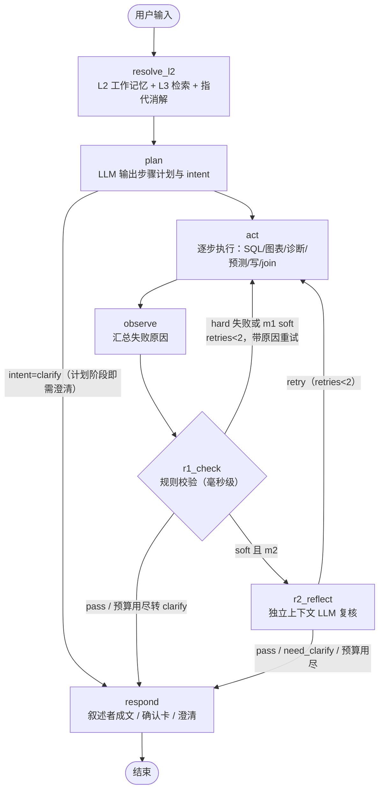
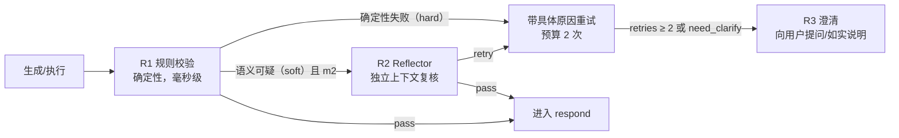
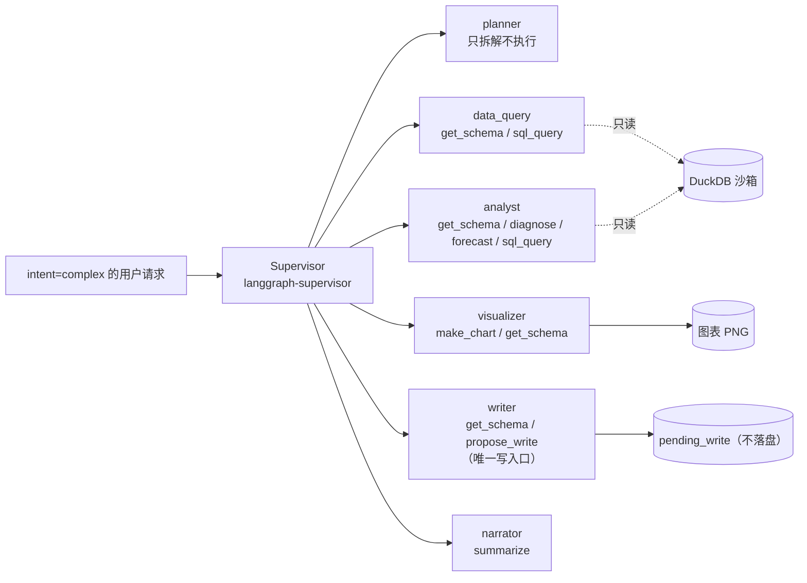
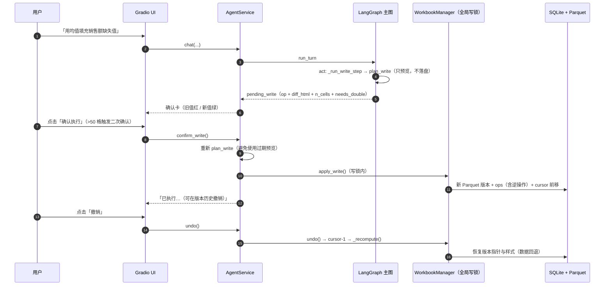

# 03 · Agent 设计

> 覆盖：LangGraph 主图、状态、反思闭环（R1/R2/R3）、多 Agent 编排（supervisor）、写操作确认流、流式与取消。
> 提示词原文见 `src/agents/prompts.py`。

## 1. 主图（LangGraph StateGraph）

- 节点与边定义：`src/agents/graph.py#build_graph`；入口 `resolve_l2`，`respond → END`。
- 条件边 `_route_after_r1` / `_route_after_r2`（`graph.py`）：
  - `r1_check`：`retry → act`、`reflect → r2_reflect`、`clarify/pass → respond`；
  - `r2_reflect`：`retry → act`，其余 `respond`。
- **重试只重跑失败步骤**：`nodes.py#act` 在带 `retry_hint` 时仅执行 `failed_step`，结果按 step_index 覆盖。
- 递归上限 `recursion_limit=64`（`graph.py#run_turn`）。

### 1.1 状态字段（`src/agents/state.py#AgentState`）

| 分组 | 字段 |
|---|---|
| 输入 | `session_id`、`workbook_id`、`user_input`、`mode`（m0/m1/m2） |
| L1 上下文 | `chat_summary`、`recent_turns` |
| L2/L3 | `resolved_input`、`l2_context`、`l3_memories` |
| 规划 | `plan`（steps + intent）、`intent` |
| 执行 | `steps_results`、`observation`、`artifacts`（charts/res_ids/report）、`pending_write` |
| 反思 | `r1_failures`、`r2_verdicts`、`retries`、`reflection_log`、`retry_hint` |
| 输出 | `response`、`need_clarification`、`confirm_required`、`trace`、`error` |

运行时临时键：`r1_outcome`、`r2_outcome`、`failed_step` 在 `nodes.py`/`graph.py` 路由中使用，
但未声明在 `AgentState` 字段列表中（每轮由 `initial_state()` 重建，实际作为图内传递值工作）。
已在 [12 项目管理 · 已知问题](12-project-management.md#4-已知问题与规格偏差) 登记。

## 2. 节点职责

| 节点 | 职责 | 关键实现 |
|---|---|---|
| `resolve_l2` | 设置/读取 active_workbook、active_sheet；Mem0 检索（limit=4）；指代词 + 有历史时做一次轻量 LLM 改写，把追问变成自包含问题（失败用原文） | `nodes.py#resolve_l2`、`#_resolve_reference` |
| `plan` | 拼 schema + L2 + L3 + 近期对话 + 重试提示，调 `PLAN_SYSTEM` 输出 JSON 计划；计划自带 `clarify` 时把 intent 置为 clarify | `nodes.py#plan` |
| `act` | intent=complex 且非重试 → supervisor；report 类自动前置两条聚合 SQL；逐步执行 `_run_step`（inspect/sql_query/chart/diagnose/forecast/summarize/report/write/join/direct_answer） | `nodes.py#act`、`#_run_step` |
| `observe` | 把失败步骤的最后一个错误并入 `error` 供 respond 使用 | `nodes.py#observe` |
| `r1_check` | m0 直接 pass；有 `pending_write` 或 intent 为 clarify/chat 时 pass；只校验最近一个 SQL 步骤：报错/超时、0 行、行数==全表、要数值回字符串、空值率>80% 等 | `nodes.py#r1_check`、`src/agents/reflector.py#r1_check` |
| `r2_reflect` | 仅 m2；把「用户问题 + schema + 生成的 SQL + 结果前几行」交给独立上下文的 Reflector（剥离执行历史，避免自我辩护），输出 `pass/retry/clarify` + 修正建议 | `nodes.py#r2_reflect_node`、`reflector.py#r2_reflect` |
| `respond` | 优先级：pending_write 确认文案（确定性，不走 LLM）→ R3 澄清 → 全部失败兜底 → 寒暄直答 → 叙述者成文；有事件绑定时 `model.stream()` 逐 token 输出 | `nodes.py#respond` |

## 3. 反思闭环（R1 → R2 → R3）

- 预算：`src/config.py#MAX_REFLECTION = 2`；第 3 次失败转 R3 澄清或如实回答「这一步没做到，原因是 X」。
- hard 失败（SQL 报错、列名不存在等）**绕过 R2 直接重试**，重试提示里带真实错误文本；
  soft 信号（0 行、过滤未生效、口径不符）在 m1 如实提示、在 m2 交 R2 复核。
- 澄清文案模板：`prompts.py#CLARIFY_TEMPLATE`，会附加「当前可用表与列」。
- 全部步骤失败也有兜底文案（`nodes.py#respond`），绝不返回编造数据。

模式差异（UI「反思模式」下拉实时切换）：

| 模式 | 行为 |
|---|---|
| m0 | 无反思：生成即执行，失败不重试 |
| m1 | 仅 R1：确定性失败带原因重试；soft 信号如实提示 |
| m2 | R1 + R2：soft 信号交 R2 独立复核后重试（评测采用） |

## 4. 多 Agent 编排（supervisor）

- 构建与缓存：`supervisor_app.py#_get_app`，缓存键 `(session_id, workbook_id)`，上限 4。
- 进入条件：`intent == "complex"` **且** 无 `retry_hint`（`nodes.py#act`）；supervisor 异常时降级回主图逐步执行。
- 三条铁律的落点：
  1. **写操作单一入口 + 串行**：只有 `writer` 挂 `propose_write`（`workers.py`），且只生成 `pending_write`；确认后的 `apply_write/undo/redo/goto/restore_snapshot` 都在 `WorkbookManager._write_lock` 内串行。
  2. **读/分析可并行**：data_query/analyst 全部只读工具，supervisor prompt 明确可同时调度。
  3. **简单请求零开销**：`simple_query/chart/diagnose/forecast/write/join/report` 均由主图直连执行，不进 supervisor。

## 5. 写操作确认流

- `pending_write` 结构：`nodes.py#_pending_write_payload`（op / diff_html / diff_dict / summary / n_cells / needs_double）。
- 二次确认阈值 50：`diff.py#needs_double_confirm`；`confirm_write` 用 `stage` 字段实现两段确认。
- 取消：`service.py#cancel_write` 只清除待定项；没有待确认修改时**不写任何会话记录**。
- 逆操作与版本语义见 [04 数据与存储](04-data-storage.md)。

## 6. 提示词清单（`src/agents/prompts.py`）

| 提示词 | 用途 |
|---|---|
| `PLAN_SYSTEM` | 意图判定 + 步骤计划（JSON）；定义 simple_query 快速路径与各意图 |
| SQL 生成提示 | 依据 schema 与用户问题生成单条 SELECT（含口径约束） |
| 写操作提示 | 12 个 LLM 可见写操作的工具说明与参数约束 |
| `R2` 复核提示 | 独立上下文复核最近 SQL 是否回答了问题 |
| `NARRATOR_SYSTEM` | 基于执行观察成文；报告类 ≤300 字、结构化；禁止编造 |
| `SUPERVISOR_PROMPT` | worker 路由规则：写操作只交 writer；读/分析可并行；聚合结果 |
| `CLARIFY_TEMPLATE` | R3 澄清话术（附当前可用表与列） |

## 7. 流式与可取消执行

- 事件通道：`src/agents/events.py#AgentEvents`（队列 + 取消 Event + ContextVar 绑定）。
- 阶段事件：主图各节点入口 `emit("stage", …)`（「规划任务 / 执行 SQL 查询 / 校验执行结果 / 生成回答…」）。
- token 事件：`respond` 中 `model.stream()` 逐字输出。
- UI 轮询：`gradio_app.py#on_send` 把 `svc.chat()` 放进后台线程，主线程每 0.12s 排空事件队列刷新界面；「停止」按钮调用 `events.cancel()`。
- 生效点：每个主图节点开头 `check_cancel()`；`graph.run_turn` 捕获 `TurnCancelled`，返回「已停止当前任务」并清空 `pending_write`。
- 评测脚本不绑定事件（同步调用），评测结果不受流式影响。
