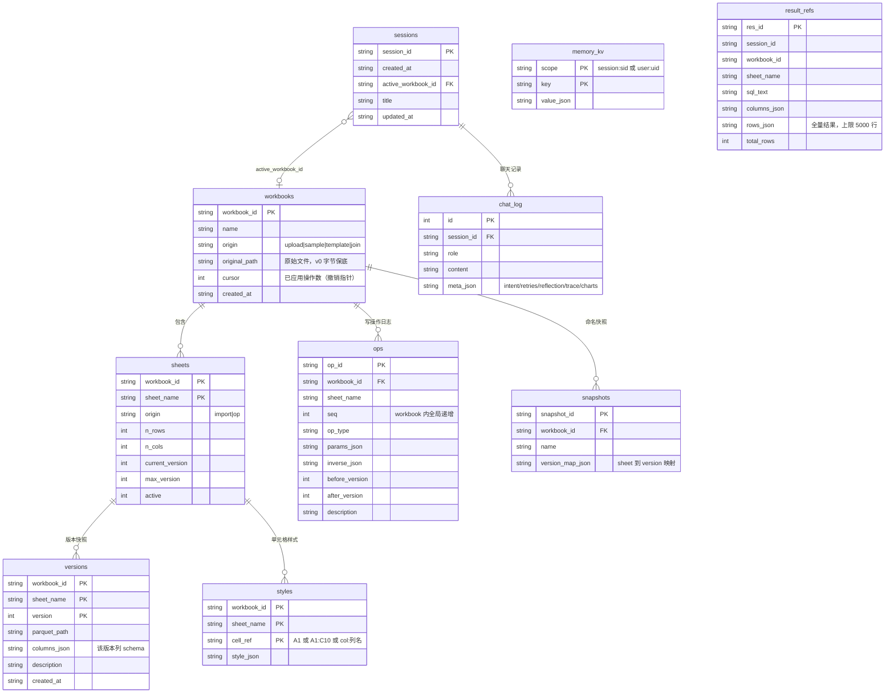
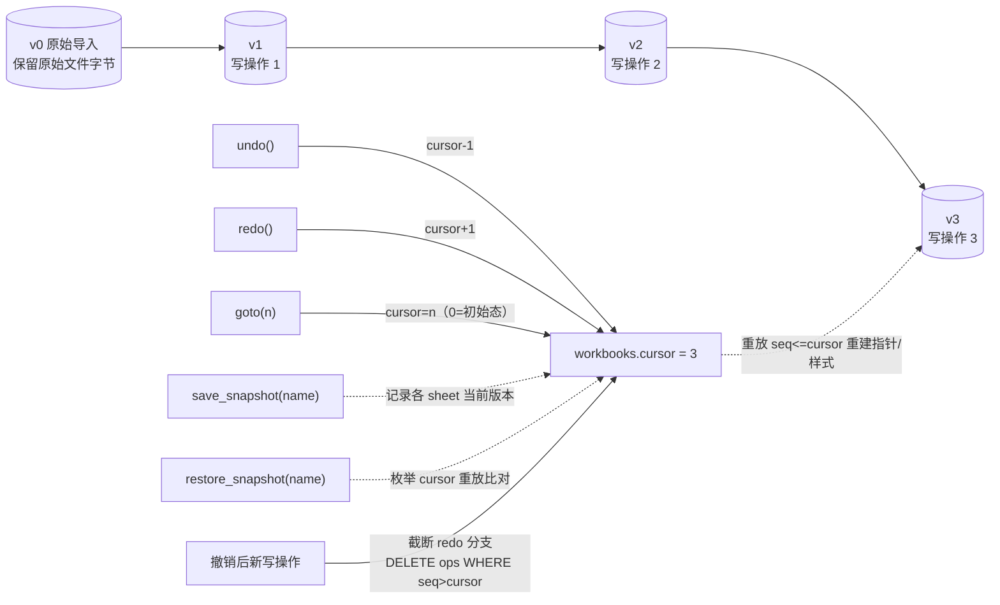

# 04 · 数据与存储

> 覆盖：Workbook 模型、SQLite 表结构、Parquet 版本链、逆操作日志、undo/redo/goto/snapshot、样式、并发。
> 代码：`src/core/storage.py`、`workbook.py`、`mutations.py`、`diff.py`。

## 1. Workbook 模型

一次导入/示例/模板/join 产生一个 `workbook`（唯一句柄 `workbook_id`）：

```
Workbook
 ├── workbook_id / name / origin(upload|sample|template|join) / original_path / cursor
 ├── sheets[]   ：sheet_name、origin(import|op)、n_rows/n_cols、current_version、max_version、active
 ├── versions[] ：每个 sheet 的 Parquet 版本快照（v0..vN）
 ├── ops[]      ：写操作日志（参数 + 逆操作 + 前后版本号）
 ├── styles[]   ：单元格样式（不进 Parquet，导出 xlsx 时套用）
 └── snapshots[]：命名快照（{sheet: version} 映射）
```

- `WorkbookManager` 是进程内单例（`workbook.py`），所有读写都经过它；DataFrame 有约 8 个的 LRU 缓存。
- 数据本体存 Parquet（`data/workspaces/<wb_id>/v{N}_{sha1}.parquet`），SQLite 只存元数据。

## 2. SQLite 表结构（data/meta.sqlite）



要点：

- `ops.seq` 在 workbook 内全局递增，是**撤销指针（cursor）的基准**；`workbooks.cursor` 记录已应用的操作数。
- `versions.columns_json` 保存该版本的列 schema，用于历史回溯与旧版本重建。
- `chat_log.meta_json` 保存每轮的 intent/retries/reflection_log/trace/charts/res_ids，是**会话回放**的数据来源。
- 旧库自动迁移：`storage.py#_migrate` 为 `sessions` 补 `title/updated_at` 列。

## 3. 写操作与版本链



- 每次写操作：`apply_write()`（写锁内）→ 执行器产出 `new_df + inverse + diff + style_writes` →
  写新 Parquet 版本 → 登记 `versions` + `ops` → `cursor+1`。
- **逆操作日志**是撤销的基石：每个执行器返回语义逆操作，例如
  `set_cell→set_cells`、`add_rows→delete_rows`、`delete_rows→add_rows`、
  `add_column→drop_column`、`drop_column→restore_column`、`fill_missing→set_cells`、
  `drop_duplicates→add_rows`、`cast_column→restore_column`、`rename_column→反向 rename`、
  `style_cells→style_restore`、`create_sheet→drop_sheet`。
- `undo/redo/goto` 不回滚数据库，而是**移动 cursor 后重放**（`workbook.py#_recompute`）：
  只重放 `seq <= cursor` 的操作，重建每个 sheet 的版本指针、active 状态与样式表，并清空 DataFrame 缓存。
- `restore_snapshot` 在链被截断（撤销后又写）导致无法回放时显式报错，而不是静默错位。

## 4. 撤销「逐字节一致」的口径（AC-5）

| 场景 | 行为 | 一致性保证 |
|---|---|---|
| 撤销回 v0（初始导入态） | `export_xlsx` 直接复制 `original_path` 的原始上传字节 | sha256 与用户上传文件一致 |
| 撤销到中间版本 | 恢复该版本 Parquet 快照 + 重放样式表 | sha256 与写前版本一致 |
| 自动化断言 | `tests/test_versions.py` | sha256 逐字节断言 |

## 5. 样式

- 样式不入 Parquet，存 `styles` 表（sheet + cell_ref → style_json）；`cell_ref` 支持 `A1`、`A1:C10`、`col:列名`。
- `style_cells` 是可撤销的普通写操作（逆操作 `style_restore` 记录旧样式）。
- 版本重放时重建样式；导出 xlsx 时由 openpyxl 套用（表头默认加粗/填色 + 样式表）。

## 6. 并发与一致性

- `WorkbookManager._write_lock = threading.Lock()`：`apply_write / undo / redo / goto / restore_snapshot` 全部串行。
- `plan_write`（预览）不在锁内——预览只是计算 diff；确认后 `confirm_write` **重新 plan_write 再 apply**，避免用过期预览落盘。
- 撤销后接新写操作会截断 redo 分支（`DELETE FROM ops WHERE seq > cursor`），保证历史线性。
- `Storage` 为线程安全单例（连接锁）；Gradio 多回调并发访问是安全的。

## 7. 存储布局与清理

| 路径 | 内容 | 清理方式 |
|---|---|---|
| `data/meta.sqlite` | 全部元数据/会话/聊天/结果引用 | 删除即重置元数据（工作簿数据仍在磁盘上，但失去索引） |
| `data/workspaces/<wb_id>/v*.parquet` | 版本快照 | 随会话/工作簿删除保留；手动清理需整目录删除 |
| `data/workspaces/charts/*.png` | 对话生成的图表 | 可安全删除（UI 引用会失效） |
| `data/checkpoints.sqlite` | LangGraph 执行轨迹 | 可删除（重建即空） |
| `data/mem0/` | qdrant 本地库 + Mem0 history.db | 删除即清空 L3 记忆 |

> 备份：拷贝 `data/` 整目录即可（含 SQLite 与 Parquet）。恢复时保持相对路径结构。
