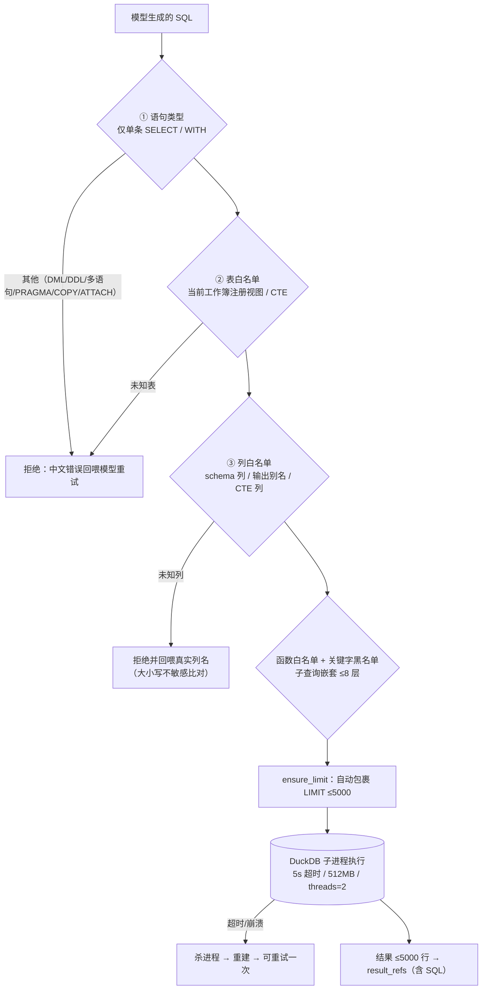

# 06 · 沙箱与安全

> 覆盖：模型生成代码（SQL/pandas）的约束、子进程隔离、资源限额、密钥管理、故障恢复。
> 代码：`src/sandbox/sqlguard.py`、`runner.py`、`sql_worker.py`、`code_runner.py`、`code_worker.py`。

## 1. 威胁模型

LLM 生成的 SQL/代码是**不可信输入**。风险与对策：

| 风险 | 对策 |
|---|---|
| 生成 DML/DDL 修改数据 | 语句类型白名单：仅单条 `SELECT/WITH` |
| 访问其他表/文件 | 表白名单：只能是当前工作簿注册的视图或 CTE |
| 引用不存在的列（幻觉） | 列名白名单：schema 列 / 输出别名 / CTE 列；拒绝并回喂真实列名 |
| 资源耗尽（大查询/死循环） | 5s 超时杀子进程重建；512MB 内存；结果 ≤5000 行 |
| 自动加载扩展/读文件 | DuckDB 禁用自动安装与扩展加载；pandas 沙箱 import 白名单 |
| 网络访问 | 无网络依赖；pandas 沙箱静态拦截 `socket/requests/urllib` |
| 密钥泄露 | Key 只在 `.env`（被 .gitignore 忽略），代码只读 `os.getenv`，不写日志 |

## 2. SQL 三层防线（`sqlguard.py`）

补充细节：

- 列名比对**大小写不敏感**（兼容 `订单ID` 这类大写 ASCII 列），错误消息返回原始列名与最接近的候选列提示。
- `AND/OR` 等二元表达式在 sqlglot 中不是函数节点，解析时按 `exp.Binary/Unary` 跳过，避免误杀。
- 校验失败**不执行**，错误文本进入重试提示（R1 hard 失败路径），典型场景「列名幻觉 → 回喂真实列名 → 修正」。

## 3. 子进程执行器

| 项 | SQL 沙箱 | pandas 沙箱（降级） |
|---|---|---|
| 进程 | `python -m src.sandbox.sql_worker`（持久，JSON over stdio） | `python -m src.sandbox.code_worker` |
| 引擎 | DuckDB 内存库，`memory_limit=512MB`、`threads=2` | pandas/numpy/datetime |
| 数据接入 | 每次把当前版本 Parquet 注册为内存表（`CREATE TABLE`），路径由主进程跟踪，写操作后自动刷新 | 传入 DataFrame 子集 |
| 超时 | 5s：杀进程并重建（`runner.py`），BrokenPipe/崩溃自动重试一次 | 5s：杀进程 |
| 结果 | `columns/rows/total_rows/elapsed_ms/truncated`，≤5000 行 | 必须赋值给变量 `result` |
| 附加限制 | 禁用扩展自动安装/加载 | import 白名单 + 静态拦截 `open/__import__/subprocess/os.system/eval/exec/socket/requests/urllib/shutil/pathlib` + 受限 builtins |

持久子进程的意义：导入一次 DuckDB 的成本被摊薄到多次查询（冷启动预热后，10 万行热态查询 5.2s，见 [10 测试与评测](10-testing-eval.md)）。

## 4. 密钥管理

- 密钥**只**放在项目根 `.env`（已被 `.gitignore` 忽略）；仓库内只有占位符模板 `.env.example`。
- 代码统一从 `src/config.py` 读取环境变量；`llm.py` 构建 OpenAI 兼容客户端，不打日志输出密钥。
- 若密钥泄露（误提交/误分享）：立即在 DeepSeek 控制台轮换，并按 [SECURITY.md](../SECURITY.md) 处理历史。
- 发布前检查（见 [09 部署与运维](09-deployment-ops.md#7-发布前安全检查)）：`git grep -nI "sk-" --cached` 必须无真实 Key。

## 5. 故障恢复与证据

| 故障 | 行为 | 证据 |
|---|---|---|
| SQL 超时 | 杀子进程 → 重建 → 用户收到明确错误；会话不中断 | `tests/test_sandbox.py::test_query_timeout_kills_worker`（AC-9） |
| 子进程崩溃（BrokenPipe） | 自动重建并重试一次 | `tests/test_sandbox.py` |
| 列名幻觉 | sqlguard 拒绝 + 真实列名回喂 → R1 hard 重试 | 评测 r1 题实测重试成功 |
| pandas 沙箱异常代码 | 静态拦截 + 超时击杀 | `tests/test_sandbox.py` |
| Mem0 不可用 | L3 降级关闭，L1/L2 不受影响 | [07 记忆层](07-memory.md#6-降级与隐私) |
