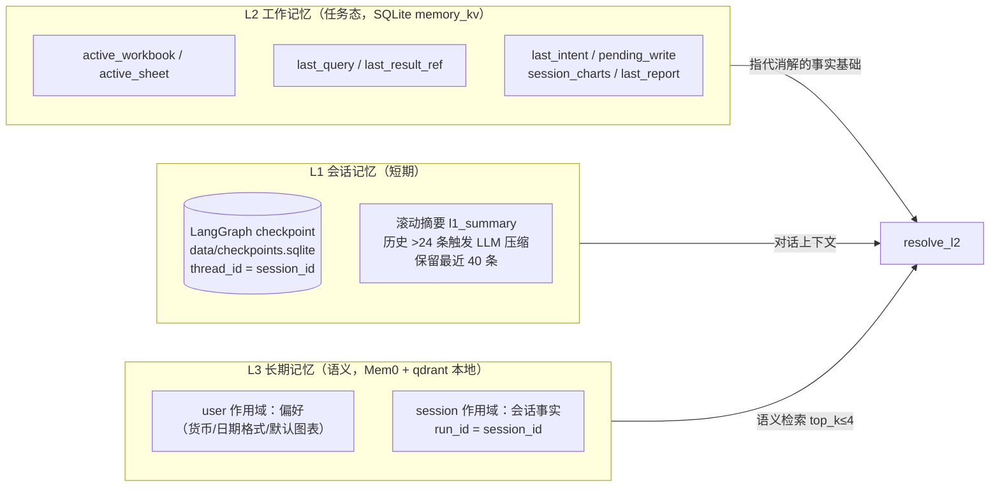
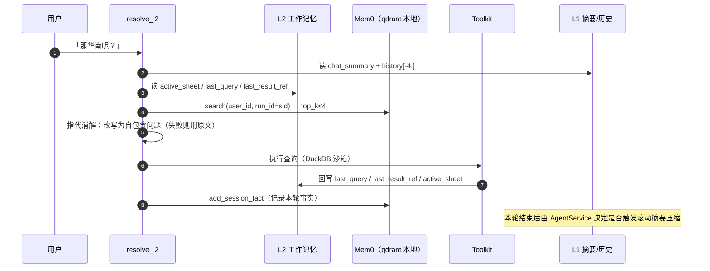

# 07 · 记忆层

> 覆盖：L1 checkpoint 与滚动摘要、L2 工作记忆、L3 Mem0 长期记忆、指代消解、降级与隐私。
> 代码：`src/agents/graph.py`、`src/service.py`、`src/memory/working.py`、`src/memory/longterm.py`、`src/agents/nodes.py#resolve_l2`。

## 1. 三层总览

分工：**L1 管「聊过什么」，L2 管「正在对哪张表/哪份结果」，L3 管「这个用户/会话的长期事实」**。
指代消解主要依赖 L2 的确定性事实，不依赖向量检索，保证「那华南呢」这类追问的稳定性。

## 2. L1：checkpoint + 滚动摘要

- checkpoint：`graph.py#_get_checkpointer`，默认 `SqliteSaver`（`data/checkpoints.sqlite`），初始化失败降级 `MemorySaver`；
  `run_turn()` 以 `thread_id=session_id` 调用，`recursion_limit=64`。checkpoint 保存的是**图执行轨迹**。
- 对话上下文由 `AgentService` 显式管理（`service.py`）：
  - 历史存 `memory_kv` 的 `session:<sid>/history`；
  - 超过 `L1_COMPRESS_THRESHOLD=24` 条时，把前一半交给 LLM 压缩成 ≤150 字摘要写入 `l1_summary`，保留最近 40 条；压缩失败退化为截断拼接；
  - 每轮注入 `chat_summary + history[-4:]` 到主图状态。
- 清空对话/删除会话会同时删除 `history`、`l1_summary` 与聊天记录（见 §6）。

## 3. L2：工作记忆（`src/memory/working.py`）

存储在 SQLite `memory_kv`，scope 为 `session:<sid>`。合法键（`_VALID_KEYS`）：

| 键 | 写入者 | 用途 |
|---|---|---|
| `active_workbook` | `resolve_l2`、`AgentService.set_workbook` | 当前工作簿 |
| `active_sheet` | `resolve_l2`、`Toolkit.query` | 当前工作表 |
| `last_query` | `Toolkit.query` | 上一条 SQL |
| `last_result_ref` | `Toolkit.query` | 上一条结果 res_id（追问/图表基于它二次加工） |
| `last_intent` | `AgentService.chat` | 上一轮意图 |
| `pending_write` | `AgentService.chat/confirm_write/cancel_write` | 待确认写操作（跨 HTTP 请求存续） |
| `session_charts` | `AgentService.chat` | 会话累计图表（追加，不清空） |
| `last_report` | 报告类轮次 | 最近一次报告文本 |

> `history`、`l1_summary` 由 `service.py` 直接走 `storage.kv_*`，不属于 `WorkingMemory._VALID_KEYS`（实现细节，见 [12 已知问题](12-project-management.md#4-已知问题与规格偏差)）。

## 4. L3：Mem0（自托管）

配置（`longterm.py#_init_mem0`）：

| 项 | 值 |
|---|---|
| LLM | `openai` provider，读 `.env` 的 `OPENAI_API_KEY/BASE_URL/MODEL`（DeepSeek） |
| Embedder | HuggingFace 本地 `paraphrase-multilingual-MiniLM-L12-v2`（384 维） |
| 向量库 | qdrant 本地模式，`collection_name=excel_agent_mem0`，路径 `data/mem0` |
| 会话作用域 | `add_session_fact` 用 `run_id=session_id`；检索按 `metadata.run_id` 过滤 |
| 用户作用域 | `add_user_preference`（user_id=`local_user`） |

写入时机（`service.py#_remember_facts`）：查询/报告/诊断/预测/复合意图记录「用户问过…」；
回答含「偏好/以后/默认」时写 user 偏好；最后写 session fact。
检索时机：`resolve_l2` 中 `search(limit=4)`，只回同会话的 session 事实。

已知行为：Mem0 的记忆条目由其内部 LLM 提取，**可能是英文短语**（即使输入是中文）；L2 工作记忆与指代消解不受影响。

## 5. 记忆读/写时序

## 6. 降级与隐私

| 场景 | 行为 |
|---|---|
| 未配置 Key | L3 初始化直接跳过（`available=False`），UI 状态栏显示「L3 记忆 已降级」；L1/L2 正常 |
| 初始化异常（离线且无本地模型、qdrant 锁被占） | 捕获并记录原因，主流程继续；所有 `add/search/list_all` 安全返回空 |
| qdrant 进程锁 | 应用与评测都单实例/串行；多进程并发时后启动者自动降级 L3 |
| 清空对话 | 删除该会话 `chat_log`、`history`、`l1_summary`、`session_charts`、`last_query/last_result_ref/last_intent/pending_write` 并重置标题 |
| 删除会话 | 删除聊天、结果引用、L2 kv 与 sessions 行（仅允许删除非当前会话） |
| L3 数据清理 | 删除 `data/mem0/` 目录即清空长期记忆 |

## 7. 记忆面板（UI）

右侧「记忆」页（`gradio_app.py#on_memory_refresh`）展示：

- **L3 长期记忆（Mem0）**：状态（已启用/降级）+ 条目列表；
- **L2 工作记忆（会话）**：当前工作簿/工作表、上一条查询、上次结果引用；
- **L1 会话摘要**：滚动摘要文本。
