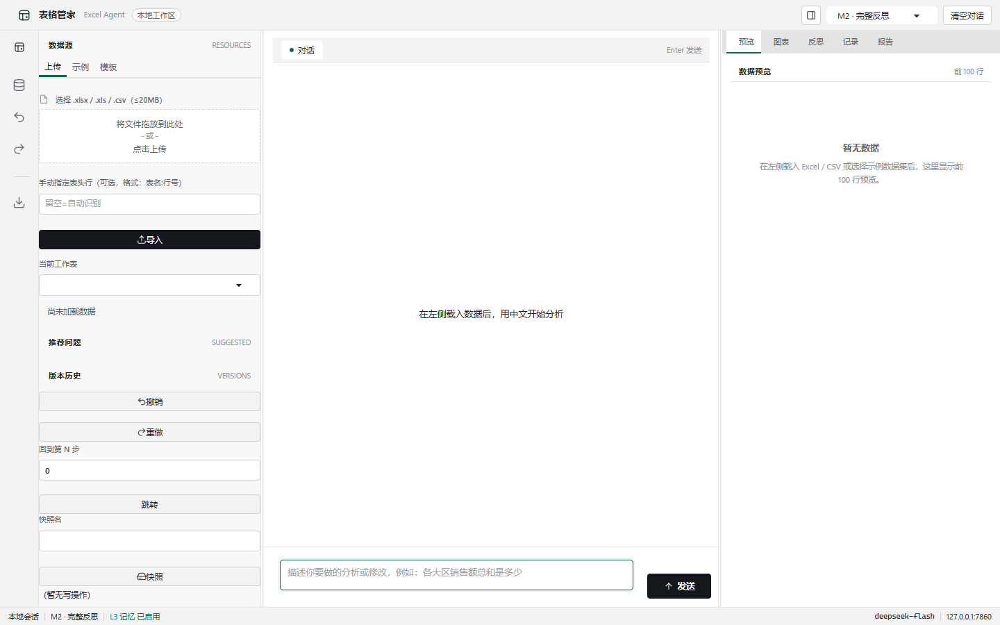
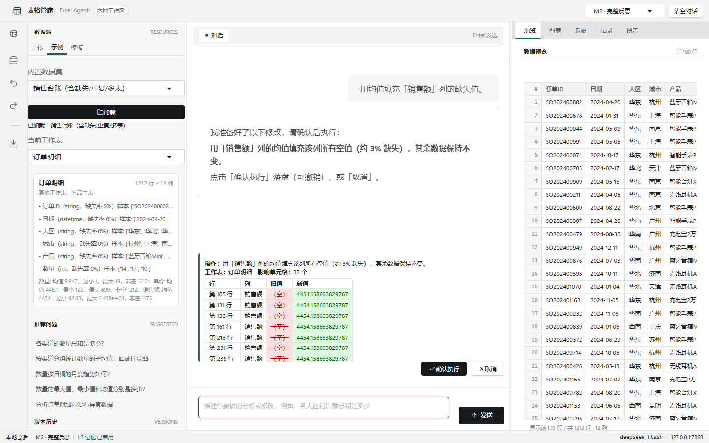
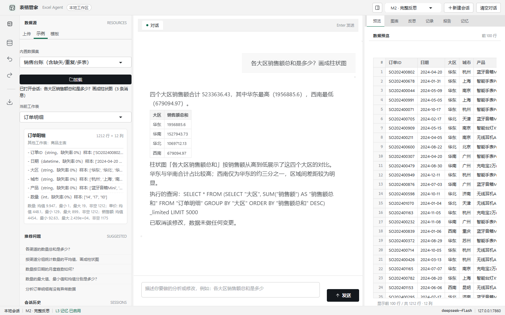
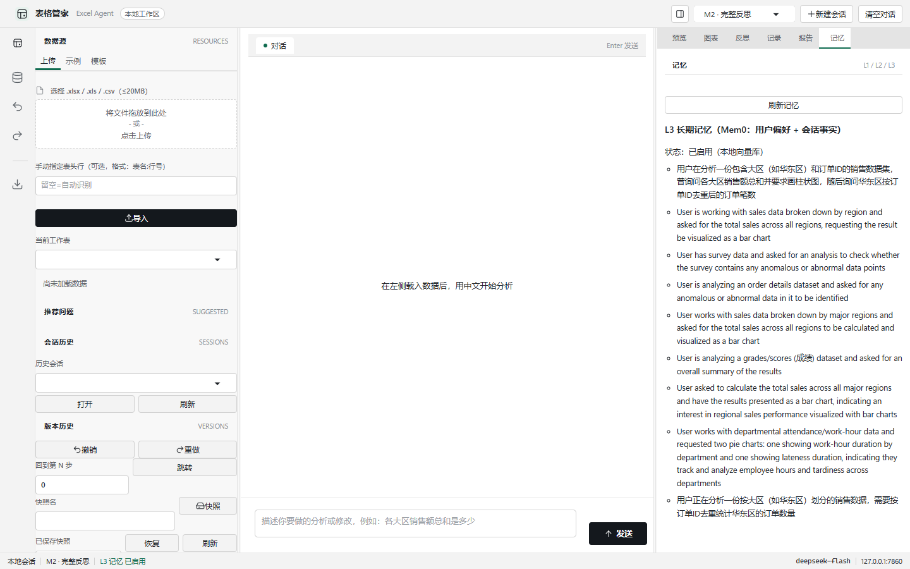
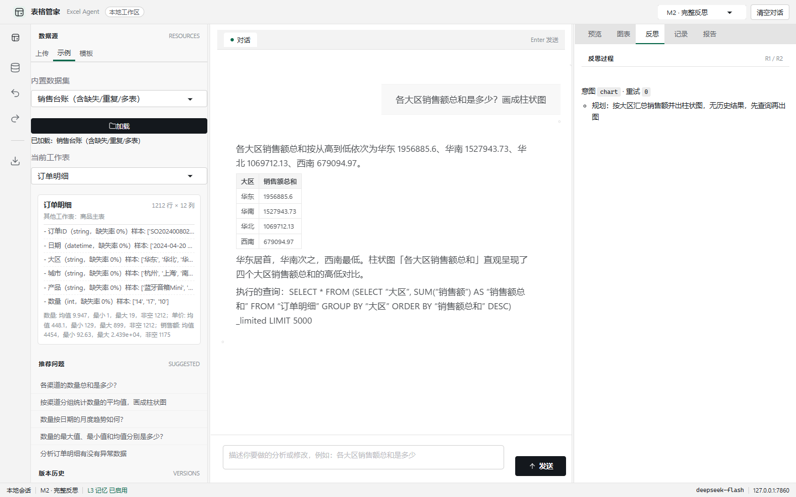

# 08 · 用户手册

> 面向使用者。截图位于 `eval/ui_shots/`；操作项的稳定 ID（用于自动化测试）见附录。

## 1. 快速开始

```powershell
# 1) 环境（一次性）
py -3.11 -m venv .venv
.venv\Scripts\python.exe -m pip install -r requirements.txt
copy .env.example .env        # 编辑 .env 填入你的 DeepSeek Key

# 2) 启动
.venv\Scripts\python.exe app.py
```

浏览器打开 `http://127.0.0.1:7860`。首次启动会下载 embedding 模型并预热沙箱（约 30–40 秒，一次性）。

## 2. 界面导览（VSCode 套壳式工作台）



| 区域 | 内容 |
|---|---|
| 标题栏 | 应用标识、侧栏开关、反思模式（M2/M1/M0）、新建会话、清空对话 |
| 活动栏 | 数据源面板开关、撤销/重做、快速导出 |
| 资源管理器 | 上传/示例/模板、工作表切换、数据卡片、推荐问题、会话历史、版本历史、导出 |
| 对话编辑器 | 对话标签页、消息流、写操作 diff 确认卡、输入框（Enter 发送）、停止/发送 |
| 检查器面板 | 预览 / 图表 / 反思 / 记录 / 报告 / 记忆 六个视图 |
| 状态栏 | 本地会话、反思模式、L3 记忆状态、模型、端口 |

布局可拖拽：拖动「资源管理器 ↔ 对话」与「对话 ↔ 检查器」之间的分隔条调整宽度（带碰撞边界），
双击分隔条恢复默认；标题栏面板图标可收起/展开侧栏。

## 3. 数据接入

三种方式（资源管理器顶部 Tab 切换）：

1. **上传**：拖入或选择 `.xlsx/.xls/.csv`（≤20MB）；表头自动识别，低置信度时在「手动指定表头行」填 `表名:行号`。
2. **示例**：内置销售台账（1212 行订单明细 + 商品主表）、考勤表、问卷；点「加载示例数据（销售台账）」最快开始。
3. **模板**：5 个 YAML 模板（销售/考勤/成绩/库存/问卷）建空表，之后用对话填数，例如「加一行：华东区，3月，12万，张三」。

多 sheet 文件用「当前工作表」下拉切换；数据卡片显示行列数、每列类型/缺失率/样本值与异常标记；
「推荐问题」点击即问。

## 4. 对话与分析

- 直接用中文提问，例如：
  - 描述：「各大区销售额总和是多少？」「数量按日期的月度趋势如何？」
  - 诊断：「分析订单明细有没有异常，并给出相关性结论」
  - 预测：「预测下季度销售额」（结果为估计值 + 置信区间，诚实标注轻量模型）
  - 处方：「帮我出一份月度经营小结，包含趋势和异常月份」
- **多轮与指代**：可以直接说「那华南呢」「按刚才的再拆一层」「把上面的结果画成柱状图」——
  工作记忆会把它改写成自包含问题（详见 [07 记忆层](07-memory.md)）。
- 每条回答末尾附「执行的查询」；「记录」页可查看历次 SQL 并复现数字。
- 运行中实时显示阶段（规划/执行 SQL/校验/生成回答），最终回答逐字流式输出；点「停止」可中断当前任务。

## 5. 写操作与撤销

写操作永远**先预览、后落盘**：

```text
你：「用均值填充『销售额』列的缺失值。」
系统：弹出 diff 确认卡（行/列/旧值红/新值绿，影响单元格数）
你：点击「确认执行」 → 落盘（>50 单元格会再确认一次）
     或点击「取消」 → 数据不变
之后：左侧「版本历史」可撤销/重做/回到第 N 步/保存命名快照/恢复快照
```

常用写操作：均值填充缺失值、删重复行、类型转换（折扣率文本→数值）、新增派生列（利润=单价×数量）、
改单元格、重命名/删除列、样式（表头加粗）。撤销回初始状态时，导出文件与原始上传**逐字节一致**（AC-5）。



## 6. 图表与导出

- 图表自动出现在右侧「图表」页；同一会话的图表**累积**（追问不出图时旧图不会消失），载入新数据时清空。
- 导出区一键导出：带样式 xlsx、PDF 报告（中文字体）、表格 PNG；下载链接显示在下方。

## 7. 会话管理

- **新建会话**：清空当前聊天/数据/图表绑定，旧会话仍保留在历史中。
- **会话历史**：列出最近 30 个会话（标题 · 更新时间 · 工作簿）；「打开」恢复聊天记录、工作簿绑定、图表与最近一次反思/查询摘要，并可继续对话；勾选确认后可删除选中会话。
- **快照**：在「版本历史」保存命名快照，之后一键恢复到该状态。
- **清空对话**：清除当前会话的聊天、摘要、图表与待确认写操作。




## 8. 反思模式与反思轨迹

- 标题栏下拉切换 M2（R1+R2，默认）/ M1（仅 R1）/ M0（无反思），现场对比。
- 右侧「反思」页展示每轮 R1/R2 的判定、重试与修复轨迹；重试预算 2 次，超限转澄清。



## 9. 常见问题（FAQ）

| 现象 | 原因与处理 |
|---|---|
| 提示「尚未配置 LLM 密钥」 | 未填 `.env` 的 `OPENAI_API_KEY`；填好后重启应用 |
| 状态栏显示「L3 记忆 已降级」 | Mem0 初始化失败（离线/模型未下载/qdrant 锁被占）；L1/L2 不受影响，长期记忆不可用 |
| 首次提问很慢 | 冷启动加载 embedding 模型 + 预热沙箱（约 30–40s，一次性） |
| 回答说「这一步没做到」 | 反思重试 2 次仍失败后如实说明，附原因；可换问法或检查列名/口径 |
| `.xls` 文件合并单元格没有填充 | `.xls` 走 pandas+xlrd 读取，不支持合并单元格填充；转存 `.xlsx` 后重试 |
| 端口被占用 | 设置环境变量 `EXCEL_AGENT_PORT=7861` 后启动 |
| 界面宽度错乱 | 双击分隔条复位；或清除浏览器 localStorage（键 `excel-agent-sidebar-w/panel-w`） |

## 附录：界面元素稳定 ID（自动化/测试用）

`btn-load-demo` `btn-upload` `btn-create-template` `sheet_dd` `composer-input` `btn-send` `btn-stop`
`btn-confirm` `btn-cancel` `btn-undo` `btn-redo` `goto_n` `snap-name` `btn-snapshot` `snap-select`
`btn-snap-restore` `session-select` `btn-session-open` `btn-session-refresh` `btn-session-delete`
`chk-delete-session` `btn-export-xlsx` `btn-export-pdf` `btn-export-png` `mode-select`
`btn-new-session` `btn-clear-chat` `btn-sidebar-toggle` `view-tabs`（预览/图表/反思/记录/报告/记忆）
