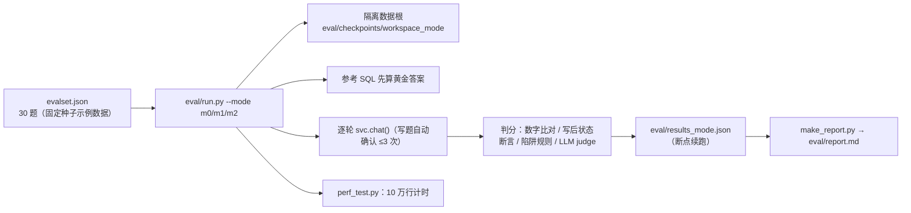
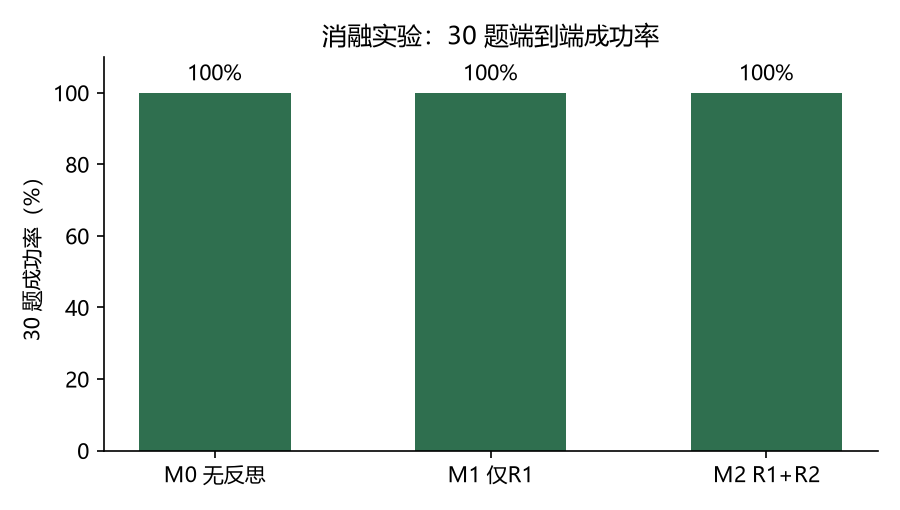
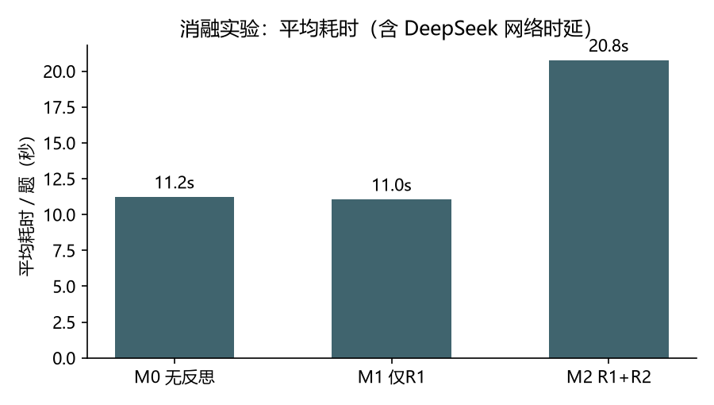

# 10 · 测试与评测

> 数据来源：`tests/`（52 个用例）、`eval/evalset.json`（30 题）、`eval/results_m0/m1/m2.json`、`eval/perf_result.json`、`eval/report.md`。
> 本文不引入第二套数字口径；重跑后请同步更新 `eval/report.md` 与本页引用。

## 1. 测试策略

三层验证：

1. **单元/集成测试（pytest，无 Key 可跑）**：覆盖导入、SQL 沙箱、版本撤销、diff、模板/MCP、事件、会话。
2. **端到端评测（30 题，需 Key）**：真实 LLM + 沙箱，黄金答案客观判分。
3. **性能测试**：10 万行单轮查询计时。

## 2. 单元/集成测试矩阵（52 个用例）

| 测试文件 | 用例数 | 覆盖 |
|---|---:|---|
| `tests/test_sqlguard.py` | 16 | 语句类型/表与列白名单/函数白名单/嵌套深度/自动 LIMIT/大小写与别名 |
| `tests/test_importer.py` | 7 | 表头探测、合并单元格、两行表头、编码（含 GB2312）、异常标记 |
| `tests/test_versions.py` | 7 | 写后版本、diff 阈值、undo/redo/goto、快照、v0 字节一致（sha256） |
| `tests/test_tools.py` | 7 | Toolkit 读工具、结果引用、推荐问题、写预览 |
| `tests/test_templates_mcp.py` | 4 | 模板 YAML、MCP tools 冒烟（in-memory Client） |
| `tests/test_sandbox.py` | 5 | 子进程超时击杀重建（AC-9）、pandas 沙箱拦截 |
| `tests/test_events.py` | 3 | 事件队列、取消标记 |
| `tests/test_sessions.py` | 3 | 会话持久化/清理/删除/空会话隐藏 |

运行：

```powershell
.venv\Scripts\python.exe -m pytest -q      # 全量，约 25–30s
.venv\Scripts\python.exe -m pytest tests/test_versions.py -q
```

## 3. 端到端评测



### 3.1 评测集构成（30 题）

| 类别 | 数量 | 说明 |
|---|---:|---|
| single 单轮查询 | 10 | 聚合/过滤/TopN/分组/同比，黄金 SQL 数字比对 |
| multi 多轮指代 | 6 | 2–3 轮追问（「那华南呢」「按刚才再拆」「只看前三个」） |
| write 修改类 | 6 | 填缺失/去重/类型转换/派生列/单元格/样式 → 写后状态断言 |
| summary 总结成文 | 4 | LLM judge + 结构检查（数字一致性、长度） |
| trap 陷阱 | 4 | 不存在的列/空集条件/要求精确预测/无活动表 → 断言澄清或诚实说明 |

### 3.2 判分方法

- **数字比对**：相对容差 0.5%、绝对 0.011；支持百分比 100x/÷100 与「下降 X%」负数写法；月份关键词自动扩展别名。
- **写后状态断言**：`no_missing / row_count / column_dtype / derived_check / cell_value / sheet_exists / style_applied`（`eval/scoring.py`）。
- **陷阱判定**：`clarify`（触发澄清）与 `honest_uncertainty`（诚实说明是估计/区间）；「是否编造具体数值」由规则 + 关键词初判，回答全文留档供人工复核（`report.md` 注明）。
- **LLM judge**：成文题 0/1 分；允许 ±5% 合理四舍五入；LLM 不可用时降级为结构检查。

### 3.3 消融口径

| 配置 | 说明 |
|---|---|
| M0 | 无反思：生成即执行，失败不重试 |
| M1 | 仅 R1 规则校验 + 带原因重试（预算 2）；soft 信号如实提示 |
| M2 | R1 + R2 Reflector（独立上下文复核）；仍失败转 R3 澄清 |

## 4. 实测结果（2026-10-26/28，DeepSeek deepseek-flash）





| 配置 | 30 题成功率 | 单轮 | 多轮 | 修改 | 成文 | 陷阱 | 平均耗时/题 | 平均重试 |
|---|---|---|---|---|---|---|---|---|
| M0 无反思 | 30/30（100%） | 10/10 | 6/6 | 6/6 | 4/4 | 4/4 | 11.2s | 0.00 |
| M1 仅 R1 | 30/30（100%） | 10/10 | 6/6 | 6/6 | 4/4 | 4/4 | 11.0s | 0.00 |
| M2 R1+R2（采用） | 30/30（100%） | 10/10 | 6/6 | 6/6 | 4/4 | 4/4 | 20.8s | 0.03 |

- M2 全程只触发 1 次 R1 重试（r1 题：子查询嵌套过深 → 简化后通过），其余题目首轮通过。
- **AC-7 如实结论**：M0→M2 提升 0pp（目标 ≥10pp），未达标。归因：本评测集上 M0 首轮已达 30/30，
  反思不是成功率的杠杆；机制在真实失败时有效（r1 题即证据）。未做任何数据修饰。
- 多 Agent 消融（单 Agent vs Supervisor）**未执行**：说明与原因见 [12 项目管理](12-project-management.md#5-路线图)。
- 分题明细与 judge 评语：`eval/report.md`。

## 5. 性能测试（AC-8）

| 指标 | 数值 | 说明 |
|---|---|---|
| 10 万行单轮查询（热态） | **5.2s** | 端到端（LLM 生成 + 沙箱执行 + 回答）≤10s 达标 |
| 冷启动预热 | 29.1s | 模型加载 + 沙箱导入，一次性，不计入查询 |
| 数据 | `eval/perf_result.json`、`perf.log` | `perf_test.py` 固定脚本生成 10 万行 CSV |

## 6. 复现命令

```powershell
# 评测（每遍约 10–20 分钟，费用约 ¥1–3；串行执行，Mem0 本地锁）
.venv\Scripts\python.exe eval\run.py --mode m0
.venv\Scripts\python.exe eval\run.py --mode m1
.venv\Scripts\python.exe eval\run.py --mode m2
.venv\Scripts\python.exe eval\make_report.py
.venv\Scripts\python.exe eval\perf_test.py

# 常用参数
#   --fresh          全量重跑
#   --filter w1      只跑某题（--fresh --filter 只重置被筛中的题）
#   --out PATH       结果另存
```

注意：

- 评测数据根隔离在 `eval/checkpoints/workspace_<mode>`，不影响 `data/`。
- 结果 JSON 支持断点续跑：中断后原命令重跑会跳过已完成题。
- 图表（本文两张 PNG）由 `scripts/make_doc_charts.py` 从 `results_*.json` 生成。

## 7. 局限与后续工作

| 局限 | 说明 | 后续 |
|---|---|---|
| AC-7 未达标 | M0 已 100%，无提升空间 | 更弱模型/更难题目重跑；扩充口径陷阱题 |
| AC-10 未自动化 | 「无编造数值」需语义级判定 | 增加数值溯源自动比对（res_id 数字 ⊆ 执行结果） |
| 多 Agent 消融缺失 | 未测量 supervisor 的增益/开销 | 构造复合请求子集对比主图直连 vs supervisor |
| 评测串行 | Mem0 本地锁限制 | `--filter` 分片 + 独立数据根手动并行 |
| 耗时受网络波动影响 | 单题耗时含 DeepSeek 时延 | 多次取均值；记录耗时分布 |
